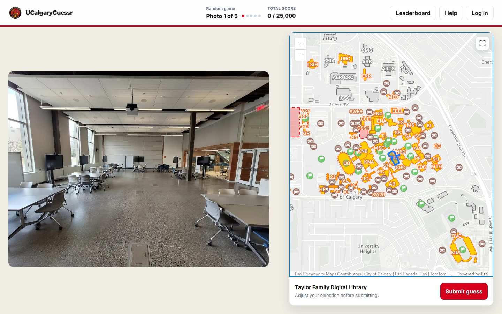
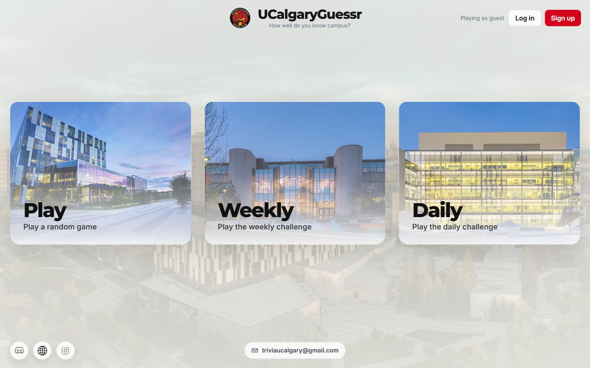
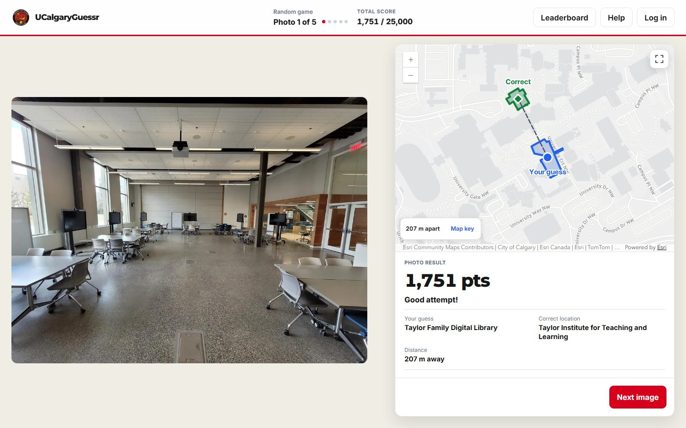
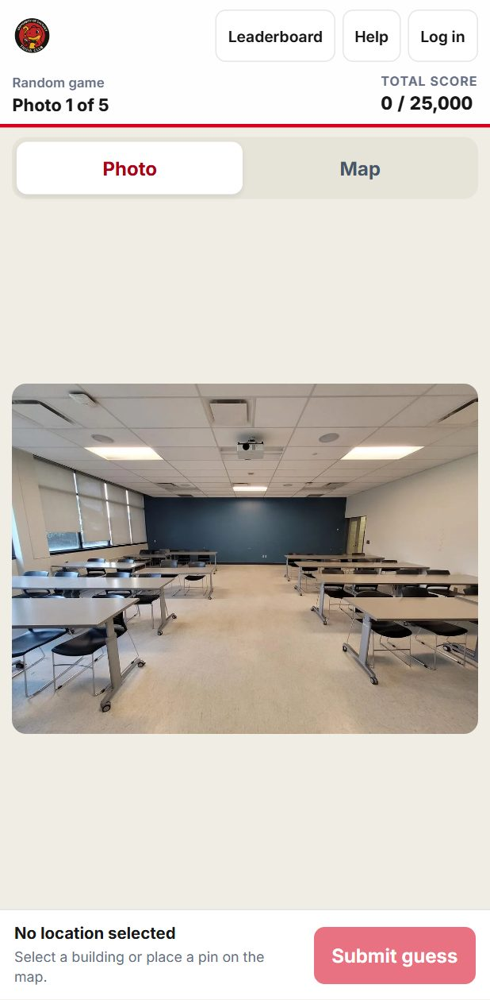
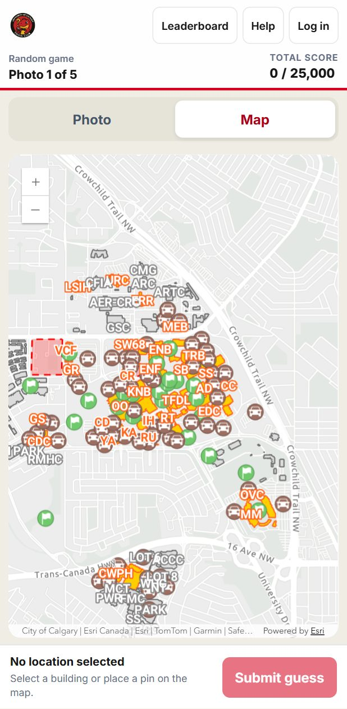

# UCalgaryGuessr 🗺️📍

A photo-based location guessing game set at the University of Calgary. Look at a campus photo and pick where you think it was taken on an interactive map!

**▶ Play now at [ucalgaryguessr.ca](https://ucalgaryguessr.ca)**

Built for the [University of Calgary Trivia Club](https://www.instagram.com/trivia.ucalgary/) with **Node.js**, **Express**, **Turso (libSQL)** and the **ArcGIS Maps SDK**, with 300+ campus photos and Play, Daily and Weekly modes.



## Screenshots

| Landing page | Result reveal |
| --- | --- |
|  |  |

| Mobile: photo | Mobile: map |
| --- | --- |
|  |  |

## Features

- **Three game modes.** **Play** is five random photos for up to 25,000 points. **Daily** and **Weekly** give everyone the same photo, with one attempt each and separate leaderboards. Challenges reset at midnight Mountain Time.
- **Server-side scoring.** Answers never reach the browser before a guess. The server scores each guess by building or by distance, with full marks for the correct building and nothing from 1 km away. Each photo can be guessed only once per round.
- **Persistent leaderboards.** Ranked Daily and Weekly results are saved to your account. Ties are broken by distance and then by active completion time, measured by a timer that pauses when you leave the challenge or switch tabs.
- **Accounts and authentication.** Sign up with a password (hashed with bcrypt), log in with an emailed magic link, or reset a forgotten password. Sessions are stored in the database, so the app runs on serverless hosting. Guests can still play unranked.
- **Same challenge for everyone.** The Daily photo is chosen deterministically from the date and saved once, so every server instance serves the same photo even when several requests arrive at the same moment. The Weekly mode is a special challenge, so photos come from a reserved pool that never appears in Daily or Play.
- **Result maps and sharing.** The result map connects your guess to the answer, and you can copy an emoji score summary to share.
- **Responsive design.** Photo and map sit side by side on desktop and switch to tabs on mobile, with scroll-to-zoom and drag-to-pan on photos. Animations respect reduced-motion preferences.
- **Automated testing.** Unit tests and Playwright browser tests run on desktop and mobile viewports.

## Technology stack

| Layer | Technology |
| --- | --- |
| Frontend | HTML, CSS, vanilla JavaScript (ES modules, no build step), ArcGIS Maps SDK for JavaScript |
| Backend | Node.js, Express 5, express-session, bcrypt, Nodemailer |
| Database | Turso / libSQL via `@libsql/client` in production; local SQLite for development and tests |
| Hosting | Vercel (serverless Express), Vercel Analytics |
| Testing | Node's built-in test runner, Playwright |

## Architecture

```
public/            Static frontend served by Express
  js/              Game state, map, UI, timer and API client modules
server/
  routes/          /api/rounds, /api/daily, /api/weekly, /api/auth
  models/          Database access for photos, challenges, scores, users and tokens
  utils/           Scoring, guess validation, challenge periods, round tracking
  services/        Database-backed session store, email delivery
  db/              Schema, photo seed and additive migrations
  data/            Campus building names and coordinates, pinned photo IDs
app.js             Express app, exported for Vercel
test/              Unit and integration tests (node --test)
tests/             Playwright browser tests
```

1. The browser requests a round or challenge and gets photo IDs and image paths, but no answers.
2. A guess, either a building or a map pin, goes to the server. The server checks that the photo belongs to the current round or challenge and hasn't already been guessed, then scores it against the stored answer.
3. Results, leaderboard entries and sessions are stored in Turso, so any serverless instance can handle the next request.

## Local development

You need **Node.js 22 or 24** and npm.

```bash
npm install
cp .env.example .env      # then set SESSION_SECRET to a long random value
npm run db:init
npm start
```

Open [http://localhost:3000](http://localhost:3000). If Turso settings are left empty, the app uses a local SQLite database. The campus map loads through ArcGIS and needs an internet connection. Use `npm run dev` to restart the server automatically when files change.

> **The game photos aren't included in this repository.** The photos are registered in the database, so the game runs, but images won't load until you add the WebP files under `public/assets/photos/`. You can add your own files or contact Sharar if you want them.

More documentation:

- [Configuration and deployment](docs/deployment.md): Turso, email, Vercel, environment variables
- [Managing game photos](docs/photos.md): folder layout, naming, Weekly photos, registering new photos

## Testing

```bash
npm test                        # unit and integration tests
npx playwright install chromium
npm run test:e2e                # browser tests on desktop and mobile
```

The tests cover scoring, game rules, challenge periods and rollover, accounts, leaderboards, map interactions, and desktop and mobile layouts. Browser tests use an isolated database and a mocked ArcGIS map. Without the photo collection, tests that need the full set are skipped and missing photos are replaced with a placeholder image.

## Licensing

Source code is licensed under [ISC](LICENSE). Images, maps, logos, icons and other assets are not covered by the code license; see [ASSET-LICENSE.md](ASSET-LICENSE.md).
